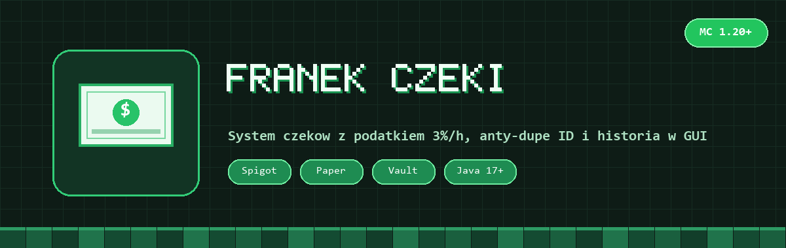
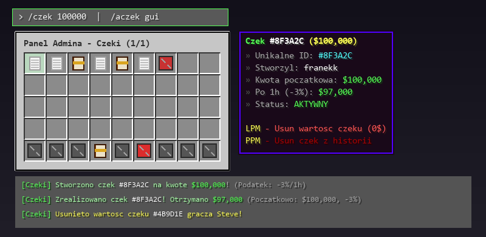

# FranekCzeki



Plugin na czeki bankowe pod ekonomie Vault z systemem podatku czasowego, unikalnymi ID przeciwko kopiowaniu itemow i historia wszystkich czekow w GUI.

Kazdy stworzony czek ma wlasne ID zapisane w przedmiocie. Jezeli gracz trzyma czek i nie zrealizuje go przez godzine, wartosc czeku spada o **3% co kazda pelna godzine** (np. z `$100,000` robi sie `$97,000`). W panelu admina mozna przegladac czeki, zerowac wartosc konkretnego czeku jednym kliknieciem albo wyczyscic cala historie.

## Podglad w grze



## Komendy

| Komenda | Co robi |
|---|---|
| `/czek <kwota>` | wyplaca hajs z konta do czeku (obsługuje też skróty typu `100k`, `1m`) |
| `/wyplac <kwota>` | działa tak samo jak `/czek <kwota>` |
| `/historiaczeki` | otwiera GUI z historia wszystkich czekow na serwerze |
| `/aczek gui` | otwiera panel admina (usuwanie wartosci danego czeku / czyszczenie historii) |
| `/aczek historia` | otwiera GUI historii czekow |
| `/aczek clear` | czysci cala historie czekow |
| `/historiaczek-clear` | czysci cala historie czekow |
| `/aczek reload` | przeladowuje `config.yml` |

## Uprawnienia

- **Gracz**: `tojak1cper.czek.use` / `franek.czek.use` (domyslnie dla kazdego, nie wymaga nadawania)
- **Admin**: `tojak1cper.czek.admin` / `franek.czek.admin` oraz `tojak1cper.czek.adminclear` / `franek.czek.adminclear` (albo `OP`)

## Config

`plugins/FranekCzeki/config.yml`, tworzy sie sam przy starcie:

```yaml
settings:
  min-amount: 100.0
  max-amount: 100000000.0
  tax-percent-per-hour: 3.0
  max-tax-percent: 90.0

cheque-item:
  material: PAPER
  glow: true
  name: "&a&lCZEK BANKOWY &8(&f#{id}&8)"
```

Wyglad czeku, lore, tytuly GUI i wszystkie wiadomosci mozna edytowac w configu. Wymaga pluginu **Vault** i dowolnej ekonomii (np. EssentialsX).

## Instalacja

Jar z folderu [`releases/`](releases/) wrzucasz do `plugins/` na serwerze (Spigot / Paper 1.20.x+) i restart.

## Budowanie

```bash
mvn package
```

Wychodzi `target/FranekCzeki-1.0.jar`.

## Licencja

Wszelkie prawa zastrzezone. Autor: franekk ([GitHub](https://github.com/Blejziak)).
